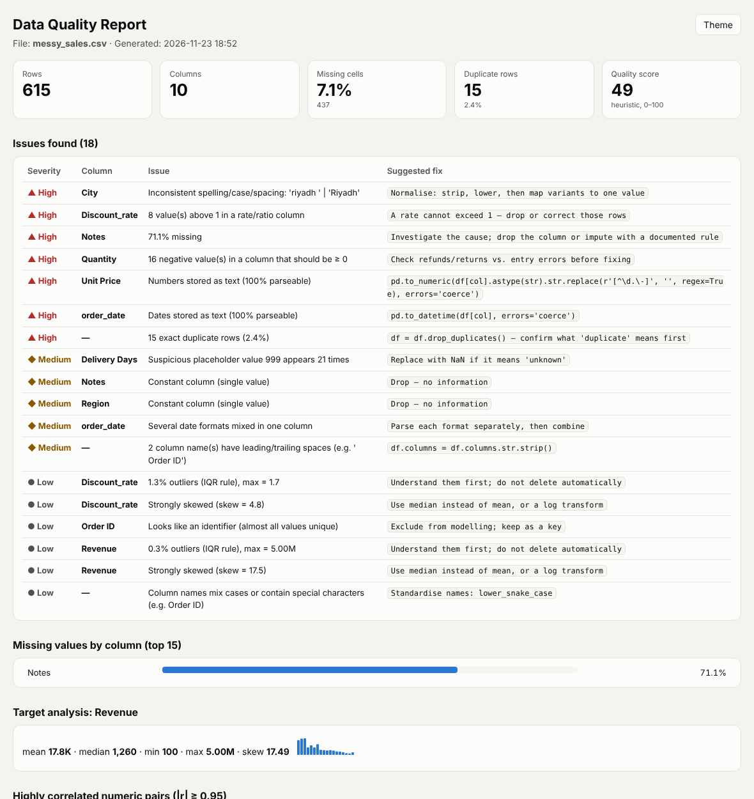
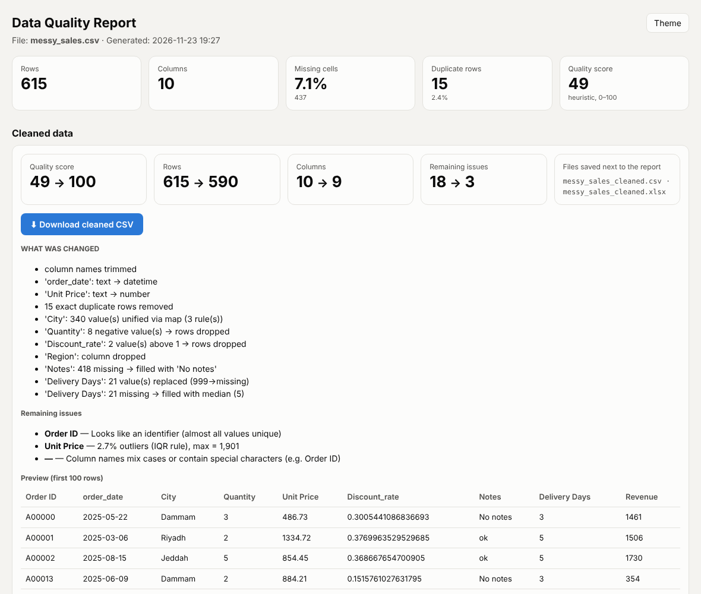
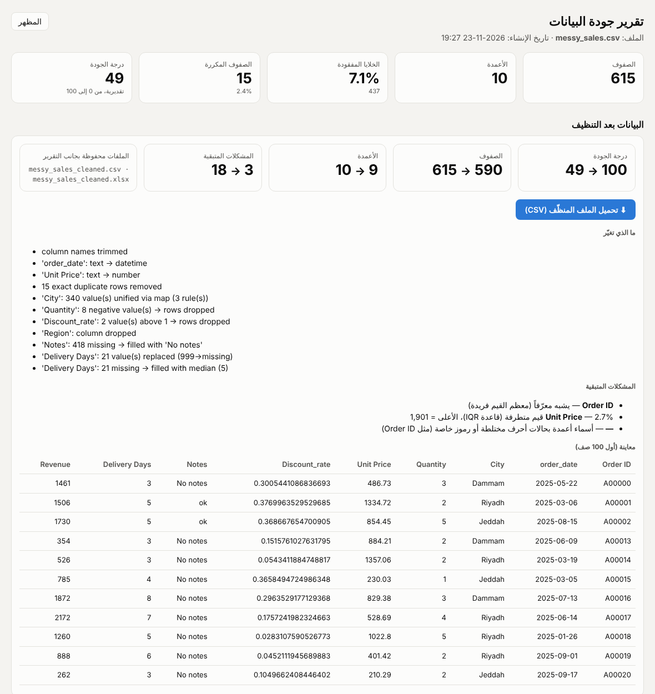

# 🔎 Data Quality Analyzer — Showcase

**English** · [العربية](#العربية)

A tool I built that turns **any messy CSV / Excel file** into a clear data-quality report, applies the **decisions agreed with the client**, and hands back a **cleaned file** — in seconds.

> **The source code is private.** This repository shows what the tool produces. Available for client engagements and on request.

| ▶ Live samples | |
|---|---|
| **1. Diagnosis** (before) | https://salehmsa.github.io/data-quality-showcase/ |
| **2. After cleaning** (decisions applied, cleaned file to view / download) | https://salehmsa.github.io/data-quality-showcase/cleaned.html |
| **3. Arabic report** | https://salehmsa.github.io/data-quality-showcase/report_ar.html |

## How it works with a client
1. **Diagnose** — the report ranks every issue by severity with a suggested fix. The client sees what is wrong, in plain language.
2. **Decide** — a rules file is generated from the findings. Each decision (negative values, missing data, outliers, spellings…) is agreed with the data owner and written down.
3. **Clean** — only the approved decisions are applied. The report then shows **quality score before → after**, exactly what changed, what remains, a preview, and a **download button** for the cleaned file (CSV, plus Excel).

## Two kinds of fixes
| | When | Examples |
|---|---|---|
| **Safe fixes** | always | trim spaces, `"1,334.72 SAR"` → number, text → date, exact duplicate rows |
| **Decisions** | only if the client approves | negatives, rates above 1, `999` placeholders, outliers, missing values, spelling variants, dropping columns |

The tool never imputes, deletes outliers or guesses categories on its own.

## What it detects
Column names with spaces · duplicate rows · numbers and dates stored as text · mixed date formats · missing values · inconsistent spellings (`Riyadh` / `riyadh ` / `الرياض`) · constant and identifier-like columns · negative quantities · rates above 1 · placeholder values · outliers and skew · highly correlated pairs · target balance and possible data leakage.

## Sample data and decisions
- [`docs/messy_sales.csv`](docs/messy_sales.csv) — a deliberately broken sales file (615 rows).
- [`docs/messy_sales_rules.yaml`](docs/messy_sales_rules.yaml) — the decisions applied in the sample.
- [`docs/messy_sales_cleaned.csv`](docs/messy_sales_cleaned.csv) — the result (590 rows, quality score 49 → 100).

## Tested on real data
Run on the 39,644-row *Online News Popularity* dataset from my [ML project](https://github.com/Salehmsa/online-news-popularity-classification), it flagged the same invalid rate values I cleaned by hand, and a `-1` placeholder in a keyword column that I had not noticed.

---

## العربية

أداة بنيتها تحوّل **أي ملف CSV أو Excel متسخ** إلى تقرير جودة واضح، وتطبّق **القرارات المتفق عليها مع العميل**، وتسلّم **ملفاً منظّفاً** — خلال ثوانٍ.

> **الكود المصدري خاص.** هذا الريبو يعرض مخرجات الأداة فقط. متاحة لمشاريع العملاء وعند الطلب.

**▶ تقرير تجريبي عربي:** https://salehmsa.github.io/data-quality-showcase/report_ar.html

**كيف تعمل مع العميل:**
1. **تشخيص:** تقرير يرتّب كل مشكلة حسب الخطورة مع الحل المقترح.
2. **قرارات:** يُولَّد ملف قواعد من النتائج، ويُتفق مع صاحب البيانات على كل قرار (السالب، المفقود، المتطرف، الإملاء…) ويُكتب.
3. **تنظيف:** تُطبَّق القرارات المعتمدة فقط، ثم يعرض التقرير الدرجة قبل/بعد وما الذي تغيّر وما بقي ومعاينة وزر **تحميل الملف المنظّف**.

**نوعان من الإصلاح:** آمن (قصّ المسافات، تحويل النص إلى رقم/تاريخ، حذف المكرر تماماً) يُطبَّق دائماً، وقرارات تُطبَّق فقط بموافقة العميل. الأداة لا تعوّض ولا تحذف الشواذ ولا تخمّن الفئات من تلقاء نفسها.

---

## Contact · للتواصل

Interested in running this on your data, or want the tool for your team?

مهتم بتنظيف بياناتك أو الحصول على الأداة؟ تواصل معي عبر LinkedIn أو البريد.

- LinkedIn: <https://www.linkedin.com/in/saleh-mahbub-aa717b159/>
- Email: <salehmahbub8@gmail.com>

## Author
**Saleh Mahbub** — [GitHub](https://github.com/Salehmsa)

